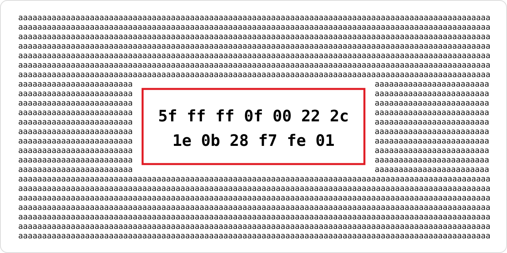

<h1 align="center">fluff</h1>

<p align="center">Tiny gzip and brotli files that expand to one repeated byte, written by hand in Rust.</p>

<p align="center">
  <a href="#quick-start"><b>Quick start</b></a> &nbsp;·&nbsp;
  <a href="#documents">Documents</a> &nbsp;·&nbsp;
  <a href="#how-it-works">How it works</a>
</p>

<p align="center">
  
</p>

fluff writes a `.gz` and a `.br` file that decompress to megabytes, or
terabytes, of a single byte: 1 MiB of `a` is about 1 KB as gzip and 13 bytes
as brotli. Use them to test decompression limits and streaming buffers, or to
see how far each format can go on the most boring input there is. The output
is streamed, so even a terabyte uses only a few kilobytes of memory.

## Quick start

```bash
make build                          # build the fluff command
make files                          # out/repeat.gz and out/repeat.br: 1 MiB of 'a'
make files C=0 SIZE=1g NAME=zero    # 1 GiB of '0' in out/zero.gz and out/zero.br
make files FORMAT=br                # only the brotli file
make verify                         # decompress them and count the bytes
make install                        # put fluff on your PATH
make                                # list every task
```

See [Using fluff](docs/usage.md) for every option.

## Documents

| Document | What's in it |
| -------- | ------------ |
| [Using fluff](docs/usage.md) | The options, examples and how to check the files |
| [How it works](docs/how-it-works.md) | The hand-written gzip and brotli streams, the source layout, and why the ratios are what they are |

## How it works

There is nothing to search for in one repeated byte, so no compression library
is used: `src/gzip/` writes a literal and then runs of 258-byte copies with
one-bit Huffman codes, the most DEFLATE allows, and `src/brotli/` writes
meta-blocks of one literal and a single copy of up to 16 MiB whose codes cost
zero bits. [How it works](docs/how-it-works.md) has the rest.

---

<p align="center"><sub>Part of <a href="https://daleobrien.github.io/#utils">Utils</a> &nbsp;·&nbsp; more at <a href="https://daleobrien.github.io">daleobrien.github.io</a></sub></p>
